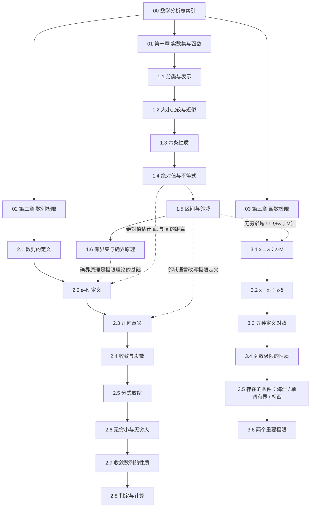

# 00 数学分析总索引

> [!abstract] 关于本库
> 本库用于沉淀《数学分析》课程笔记，采用「**总索引（MOC）+ 按章拆分**」结构。
> **整理原则**：原文条目全部保留；表述规范化；原稿中的笔误与不严谨之处已直接修正，正文即为终稿；原文未写但逻辑必需的内容以 `[!info] 补充` 标注。
> **标签体系**：`#数学分析/<章>/<主题>`，如 `#数学分析/实数/表示法`、`#数学分析/极限/定义`。

---

## 一、章节导航

| 序号 | 章节 | 覆盖内容 | 文件 |
| :--: | :-- | :-- | :-- |
| 01 | 第一章 实数集与函数 | 实数的分类与表示、大小比较与近似、六条性质、绝对值与不等式、区间与邻域、有界集与确界原理 | [[01 第一章 实数集与函数]] |
| 02 | 第二章 数列极限 | 数列的定义、ε–N 定义、几何意义、收敛与发散、分式放缩、无穷小与无穷大、收敛数列的性质、极限存在的条件与计算 | [[02 第二章 数列极限]] |
| 03 | 第三章 函数极限 | x→∞ 的 ε–M 定义、x→x₀ 的 ε–δ 定义、左/右极限与双侧关系、五种定义对照、函数极限的性质、函数极限存在的条件、两个重要极限 | [[03 第三章 函数极限]] |

### 小节索引

**第一章**

1. [[01 第一章 实数集与函数#1.1 实数的分类与无限小数表示|1.1 实数的分类与无限小数表示]] —— 有理数、循环小数化分数、正规表示
2. [[01 第一章 实数集与函数#1.2 实数的大小比较与近似|1.2 实数的大小比较与近似]] —— 逐位比较、不足/过剩近似、稠密性例题
3. [[01 第一章 实数集与函数#1.3 实数的六条性质|1.3 实数的六条性质]] —— 封闭性、有序性、传递性、阿基米德性（含证明）、稠密性、数轴
4. [[01 第一章 实数集与函数#1.4 绝对值与不等式|1.4 绝对值与不等式]] —— 绝对值性质、三角不等式（含证明）
5. [[01 第一章 实数集与函数#1.5 区间与邻域|1.5 区间与邻域]] —— 四类区间、邻域及其变形
6. [[01 第一章 实数集与函数#1.6 有界集与确界原理|1.6 有界集与确界原理]] —— 上下界、有界集、取整函数、上下确界、确界原理

**第二章**

1. [[02 第二章 数列极限#2.1 数列的定义|2.1 数列的定义]]
2. [[02 第二章 数列极限#2.2 数列极限的 ε–N 定义|2.2 数列极限的 ε–N 定义]]
3. [[02 第二章 数列极限#2.3 极限的几何意义|2.3 极限的几何意义]]
4. [[02 第二章 数列极限#2.4 收敛与发散|2.4 收敛与发散]]
5. [[02 第二章 数列极限#2.5 分式放缩技巧|2.5 分式放缩技巧]]
6. [[02 第二章 数列极限#2.6 无穷小数列与无穷大数列|2.6 无穷小数列与无穷大数列]] —— 无穷小的定义、无穷大与非正常极限、无界与无穷大的区别
7. [[02 第二章 数列极限#2.7 收敛数列的性质|2.7 收敛数列的性质]] —— 唯一性、有界性、保号性、保不等式性、迫敛性、四则运算、子列定理
8. [[02 第二章 数列极限#2.8 数列极限存在的条件与计算方法|2.8 极限存在的条件与计算]] —— 五条判定途径、八条常用结论、运算法则条件、Stolz 定理
9. [[02 第二章 数列极限#本章小结|本章小结]] —— 数列 → 极限 → {无穷小、无穷大、收敛}；数列 → 发散

**第三章**

1. [[03 第三章 函数极限#3.1 x 趋近于 ∞ 时函数的极限|3.1 x 趋近于 ∞ 时函数的极限]] —— ε–M 定义、$x\to+\infty$ 与 $x\to-\infty$、双侧刻画
2. [[03 第三章 函数极限#3.2 x 趋近于 x₀ 时函数的极限|3.2 x 趋近于 x₀ 时函数的极限]] —— ε–δ 定义、左/右极限、双侧与单侧的关系
3. [[03 第三章 函数极限#3.3 五种定义的对照|3.3 五种定义的对照]] —— 五行结构对照表
4. [[03 第三章 函数极限#3.4 函数极限的性质|3.4 函数极限的性质]] —— 唯一性、局部有界性、局部保号性、迫敛性、四则运算、复合函数极限（含证明）
5. [[03 第三章 函数极限#3.5 函数极限存在的条件|3.5 函数极限存在的条件]] —— 海涅定理（归结原则）、单调有界定理、柯西准则
6. [[03 第三章 函数极限#3.6 两个重要极限|3.6 两个重要极限]] —— $\lim\frac{\sin x}{x}=1$、$\lim(1+\frac{1}{x})^{x}=e$、$1^{\infty}$ 型例题
7. [[03 第三章 函数极限#小结|小结]] —— 两种极限过程与各自的分支

---

## 二、知识主线

> [!tip] 主线逻辑
> 实数 → 比较与近似（把实数化归为有理数）→ 六条性质 → 用绝对值刻画"距离" → 用邻域刻画"附近" → 用确界原理保证"最小上界存在" → 最终以 ε–N 语言定义数列极限。
> 前三者的价值全部在第二章兑现：**绝对值给距离，邻域给范围，确界给存在性**。

---

## 三、符号与约定

| 符号 | 含义 |
| :-- | :-- |
| $\mathbb{N}_+$ / $\mathbb{N}$ | 正整数集 / 自然数集 |
| $\mathbb{R}$ | 实数集 |
| $\bar x_n$ | $x$ 的 $n$ 位不足近似 |
| $\hat x_n$ | $x$ 的 $n$ 位过剩近似，$\hat x_n=\bar x_n+10^{-n}$ |
| $U(a;\varepsilon)$ | 点 $a$ 的 $\varepsilon$ 邻域 |
| $U^{\circ}(a;\varepsilon)$ | 去心邻域 |
| $\sup S$ / $\inf S$ | 上确界 / 下确界 |

---

## 四、本库文件命名规则

| 类别 | 规则 | 示例 |
| :-- | :-- | :-- |
| 总索引 | `00 数学分析总索引.md` | 固定为 `00`，永远排在最前 |
| 章节笔记 | `NN 第X章 章名.md`，`NN` 为两位序号 | `01 第一章 实数集与函数.md`、`02 第二章 数列极限.md` |
| 附件图片 | `笔记原图-NN 主题.jpg`，`NN` 对应原图页序 | `笔记原图-03 绝对值与不等式.jpg` |
| 成品导出 | 放 `attachments/`，名称含用途说明 | `数学分析笔记 阅读版快照.html` |

> [!note] 命名要点
> ① 所有笔记以两位数字序号开头，保证文件浏览器中的**顺序稳定**，不受拼音/笔画排序影响；
> ② 序号与标题之间用一个半角空格分隔，Obsidian 的 `[[ ]]` 链接可直接识别；
> ③ 标题不加标点、不含 `/ \ : * ? " < > |` 等在 Windows 下非法的字符；
> ④ 附件与笔记分目录存放，避免根目录混杂；
> ⑤ 后续新增章节沿用 `03`、`04`……；新增同类批次可在索引中追加「整理批次」字段。

---

## 五、原图索引

| 页序 | 原图 | 主要覆盖 |
| :-: | :-- | :-- |
| 01 | [[笔记原图-01 实数的分类与大小比较.jpg]] | 1.1 分类与正规表示、1.2 比较与近似、例题 1 |
| 02 | [[笔记原图-02 实数的六条性质.jpg]] | 1.3 六条性质与阿基米德性证明 |
| 03 | [[笔记原图-03 绝对值与不等式.jpg]] | 1.4 绝对值性质与三角不等式 |
| 04 | [[笔记原图-04 区间与邻域.jpg]] | 1.5 区间与邻域 |
| 05 | [[笔记原图-05 有界集与确界原理.jpg]] | 1.6 上下界、确界与确界原理 |
| 06 | [[笔记原图-06 数列极限的概念.jpg]] | 2.1–2.5 数列极限概念 |
| 07 | [[笔记原图-07 数列极限的概念 修订稿.png]] | 第二章修订稿：2.6 无穷小与无穷大、本章小结 |
| 08 | [[笔记原图-08 收敛数列的性质.png]] | 2.7 收敛数列的性质（含子列与小节小结） |
| 09 | [[笔记原图-09 极限存在的条件与计算.png]] | 2.8 判定途径、常用结论、Stolz 定理 |
| 10 | [[笔记原图-10 函数极限的概念.png]] | 3.1–3.2 函数极限的 ε–M 与 ε–δ 定义、左/右极限 |
| 11 | [[笔记原图-11 函数极限的性质.png]] | 3.4 六条性质、复合函数极限定理及证明、小结 |
| 12 | [[笔记原图-12 函数极限存在的条件与两个重要极限.png]] | 3.5 三条判据、3.6 两个重要极限及例题 |

---
