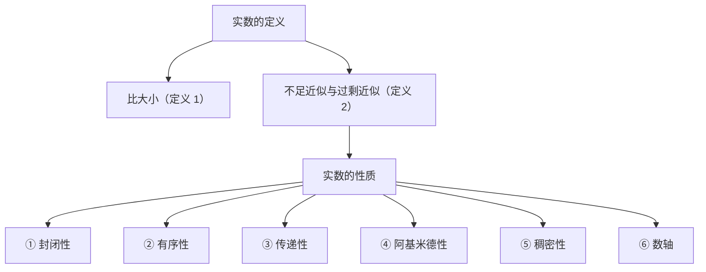
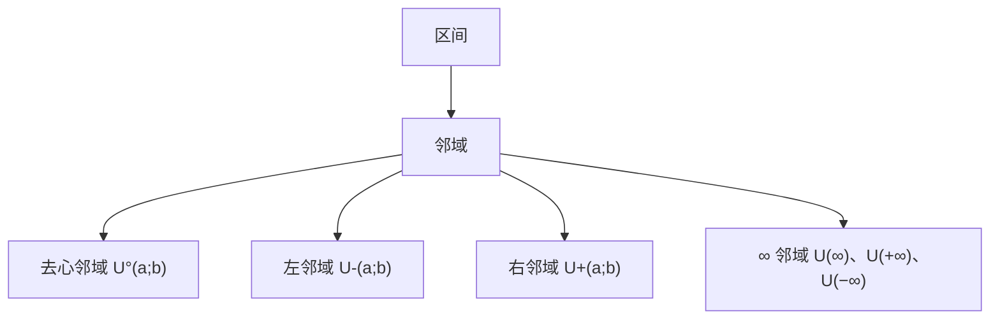
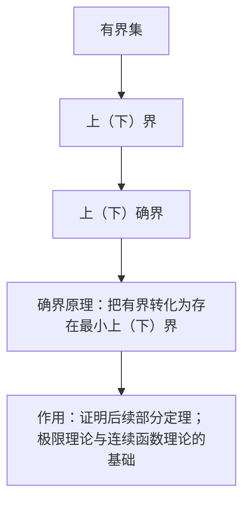

# 第一章 实数集与函数

> [!abstract] 本章导航
> **层级**：1.1 分类与表示 → 1.2 大小比较与近似 → 1.3 六条性质 → 1.4 绝对值与不等式 → 1.5 区间与邻域 → 1.6 有界集与确界原理
> **位置**：[[00 数学分析总索引]] ｜ 下一章：[[02 第二章 数列极限]]
> **核心线索**：实数统一用无限小数表示 → 逐位比较与有理近似 → 六条性质 → 绝对值度量距离 → 邻域描述"附近" → 确界原理提供存在性。

---

## 1.1 实数的分类与无限小数表示

`关键词：实数的分类 · 有理数 · 正规表示`

### 1.1.1 有理数的范围

有理数包括：**整数、有限小数、无限循环小数、分数**。

**定义**：凡可写成 $\dfrac{p}{q}$（$p,q$ 均为整数，且 $q\neq 0$）形式的数都是有理数；反过来，有理数都可以写成分数形式。

> [!tip] 统一表示的动机（原笔记以绿框强调）
> 为了**将有理数和无理数统一用无限小数表示**。只有把实数一律写成无限小数，后续的逐位比较、不足/过剩近似、确界讨论才有统一语言。

### 1.1.2 把循环小数化为分数

**例 1** 证明 $0.\overline{9}=1$。

$$
\begin{aligned}
\text{设 }x &= 0.\overline{9}\\
10x &= 9.\overline{9}\\
9x &= 9.\overline{9}-x = 9\\
x &= 1
\end{aligned}
$$

**例 2** 求 $0.\overline{7}$ 的值。

$$
\begin{aligned}
\text{设 }x &= 0.\overline{7}\\
10x &= 7.\overline{7}\\
9x &= 7.\overline{7}-x = 7\\
x &= \tfrac{7}{9}
\end{aligned}
$$

> [!tip] 方法要点
> 设 $x=0.\overline{a}$（$a$ 为一位循环节），则 $10x-x=9x=a$，故 $x=\dfrac{a}{9}$。

### 1.1.3 实数的正规表示

$$
x=a_0.a_1a_2\cdots a_n\cdots=a_0.a_1a_2\cdots(a_n-1)999\cdots
$$

- 当 $x=a_0$ 为正整数时，$x=(a_0-1).999\cdots$；
- 规定 $0=0.000\cdots$。

> [!info] 为何要"正规"
> 同一实数有两种无限小数写法（末位全 9 与有限小数）。若不先约定正规表示，1.2 节的"逐位比较"就会出现同一数被判为不等的歧义；约定后表示（除 $0.\overline{9}=1$ 这类等价外）唯一，定义才是良定的。

**标签**：#数学分析/实数/表示法 #数学分析/小数/循环小数

---

## 1.2 实数的大小比较与近似

`关键词：定义一：比大小 · 定义 2：不足近似与过剩近似`

### 1.2.1 定义 1（比大小）

设

$$
x=a_0.a_1a_2\cdots a_n\cdots,\qquad y=b_0.b_1b_2\cdots b_n\cdots
$$

① 若 $a_k=b_k\ (k=0,1,2,\cdots)$，则 $x=y$；

② 若存在非负整数 $l$，使前 $l+1$ 位相同而第 $l+1$ 位起有 $a_{l+1}>b_{l+1}$，即

$$
a_k=b_k\ (k=0,1,\cdots,l)\quad\text{而}\quad a_{l+1}>b_{l+1},
$$

则 $x>y$。

### 1.2.2 定义 2（不足近似与过剩近似）

设 $x=a_0.a_1a_2\cdots a_n\cdots$。

- **$n$ 位不足近似**：$\bar x_n=a_0.a_1a_2\cdots a_n$（把 $a_n$ 之后的数字全部去掉），它**不大于** $x$，即 $\bar x_n\le x$；
- **$n$ 位过剩近似**：$\hat x_n=\bar x_n+\dfrac{1}{10^n}$（在第 $n$ 位进 1），它**恒大于** $x$，即 $\hat x_n>x$。

**单调性**：$n$ 增大时，$\bar x_n$ **不减**；$\hat x_n$ **不增**。

**比较判据**：

$$
x>y\iff \text{存在非负整数 } n,\ \text{使 } \bar x_n>\hat y_n .
$$

**关键结论**：$\bar x_n$ 与 $\hat x_n$ 都是**有理数**——这是把"实数比较"化归为"有理数构造"的桥梁。

### 1.2.3 例题 1：有理数的稠密性

> [!example] 题目
> 设 $x,y$ 为实数，$x<y$，证明存在有理数 $r$，使得 $x<r<y$。（稠密性）

**证明**：因 $y-x>0$，由[[01 第一章 实数集与函数#1.3 实数的六条性质|阿基米德性]]，存在正整数 $n$ 使 $\dfrac{1}{10^n}<y-x$。取 $x$ 的 $n$ 位过剩近似

$$
r=\hat x_n=\bar x_n+\frac{1}{10^n}\in\mathbb{Q}\quad(\text{有限小数必为有理数}),
$$

由过剩近似定义得 $x<r$；又 $\bar x_n\le x$，故

$$
r=\bar x_n+\frac{1}{10^n}\le x+\frac{1}{10^n}<x+(y-x)=y .
$$

于是 $x<r<y$，即 $x,y$ 之间存在有理数 $r$。$\blacksquare$

> [!tip] 要点
> 证明的关键是"**只取 $x$ 的过剩近似，并把步长 $10^{-n}$ 压到小于 $y-x$**"。$r$ 由单一数列的近似值构造，误差可控；若同时取 $x$ 与 $y$ 的近似值再取中点，两个误差会叠加，无法保证 $r$ 落入 $(x,y)$。

> [!info] 原图对照（第 1 页）
> 覆盖 1.1–1.2 及例题 1 的手写原稿。
> ![[笔记原图-01 实数的分类与大小比较.jpg|620]]

**标签**：#数学分析/实数/大小比较 #数学分析/实数/近似 #数学分析/实数/稠密性

---

## 1.3 实数的六条性质

`关键词：实数的性质 · R = {x | x 为实数}`

1. **封闭性**：实数集 $\mathbb{R}$ 对加、减、乘、除（除数不为零）封闭，即实数经四则运算后结果仍为实数。
2. **有序性**：对任意 $a,b$，$a<b$、$a=b$、$a>b$ 三者**有且仅有一个**成立。
3. **传递性**：若 $a>b$，$b>c$，则 $a>c$。
4. **阿基米德性**：设 $a>0$，$b\in\mathbb{R}$，则存在正整数 $n$，使 $na>b$。
5. **稠密性**：任意两个不相等的实数之间必有另一实数，且**既有有理数**（见 [[01 第一章 实数集与函数#1.2 实数的大小比较与近似|1.2.3 例题 1]]）**又有无理数**。
6. **数轴**：实数与数轴上的点对应关系，与中学阶段所学一致。

### 1.3.1 阿基米德性的证明

**① $a>b>0$**：取 $n=1$，则 $na=a>b$，即可。

**② $a=b>0$**：取 $n=2$，则 $na=2a>a=b$，即可。

**③ $b>a>0$**：

设 $b=b_0.b_1b_2\cdots b_n\cdots$，其整数部分 $b_0=k\in\mathbb{N}$，于是

$$
k\le b<k+1\le 10^{k+1}.
$$

设 $a=a_0.a_1a_2\cdots a_n\cdots$，记 $a_p$ 为 $a$ 的小数部分中**第一个非零数字**（位于小数点后第 $p$ 位，$p\ge 1$），即

$$
a=0.\underbrace{00\cdots 0}_{p-1\text{ 个}}a_p a_{p+1}\cdots
$$

则

$$
10^{p+k+1}a=10^{k+1}\cdot 10^{p}a=10^{k+1}\cdot a_p.a_{p+1}a_{p+2}\cdots\ \ge 10^{k+1}>b,
$$

故当 $n=10^{p+k+1}$ 时，$na>b$。

**④ $b\le 0$**：由 $a>0$ 取 $n=1$，即 $na=a>0\ge b$。

至此，$a>0$、$b$ 为任意实数的情形全部覆盖（①②③ 覆盖 $b>0$，④ 覆盖 $b\le 0$）。

### 1.3.2 小结

> [!info] 原图对照（第 2 页）
> 六条性质与阿基米德性证明原稿。
> ![[笔记原图-02 实数的六条性质.jpg|620]]

**标签**：#数学分析/实数/性质 #数学分析/实数/阿基米德性 #数学分析/实数/稠密性

---

## 1.4 绝对值与不等式

`关键词：绝对值的定义 · 绝对值的性质`

### 1.4.1 定义

$$
|a|=\begin{cases}
a, & a\ge 0,\\[2pt]
-a, & a<0.
\end{cases}
$$

**几何意义**：$|a|$ 表示数 $a$ 到原点的距离。

### 1.4.2 性质

① $|a|=|-a|\ge 0$，且 $|a|=0\iff a=0$；

② $-|a|\le a\le |a|$；

③ $|a|<h\iff -h<a<h$，$\quad |a|\le h\iff -h\le a\le h$；

④ **三角不等式**：设 $a,b\in\mathbb{R}$，则

$$
\bigl||a|-|b|\bigr|\le |a\pm b|\le |a|+|b| .
$$

### 1.4.3 三角不等式的证明

由 ② 得 $-|a|\le a\le |a|$，$-|b|\le b\le |b|$；两式相加得

$$
-(|a|+|b|)\le a\pm b\le |a|+|b| .
$$

由 ③ 得

$$
|a\pm b|\le |a|+|b| .
$$

（对 $a-b$ 的情形：令 $b:=-b$，由 $|a+b|\le |a|+|b|$ 得 $|a-b|\le |a|+|b|$。）

另一方面，由 $|a|=|(a-b)+b|\le |a-b|+|b|$ 得

$$
|a|-|b|\le |a-b| ;
$$

再令 $b:=-b$，得 $|a|-|b|\le |a+b|$，故

$$
|a|-|b|\le |a\pm b| .
$$

交换 $a,b$ 的地位同理有 $|b|-|a|\le |a\pm b|$。综上，

$$
\bigl||a|-|b|\bigr|\le |a\pm b|\le |a|+|b| . \qquad\blacksquare
$$

### 1.4.4 小结

> [!info] 原图对照（第 3 页）
> ![[笔记原图-03 绝对值与不等式.jpg|620]]

**标签**：#数学分析/实数/绝对值 #数学分析/不等式/三角不等式

---

## 1.5 区间与邻域

`关键词：区间 · 邻域`　（原笔记此处属"二、数集 确界原理"的开头）

### 1.5.1 区间

设 $a,b\in\mathbb{R}$，$a<b$：

| 集合 | 记号 | 名称 | 类型 |
| :-- | :-- | :-- | :-- |
| $\{x\mid a<x<b\}$ | $(a,b)$ | 开区间 | 有限区间 |
| $\{x\mid a\le x\le b\}$ | $[a,b]$ | 闭区间 | 有限区间 |
| $\{x\mid a\le x<b\}$ | $[a,b)$ | 半开半闭区间 | 有限区间 |
| $\{x\mid x\ge a\}$ | $[a,+\infty)$ | 无限区间 | 无限区间 |

> [!info] 补充
> 同型地还有 $(a,b]$、$(-\infty,b]$、$(-\infty,+\infty)=\mathbb{R}$ 等。有限区间的共同特征是**有界**（见 [[01 第一章 实数集与函数#1.6 有界集与确界原理|1.6]]）。

### 1.5.2 邻域

**定义**：设 $a\in\mathbb{R}$，$b>0$，则满足 $|x-a|<b$ 的全体 $x$ 的集合称为点 $a$ 的 **$b$ 邻域**，记为

$$
U(a;b)=\{x\mid |x-a|<b\}=(a-b,\ a+b),
$$

其中 $a$ 为中心，$b$ 为**半径**（原笔记以黄色标出）。

**去心（空心）邻域**：

$$
U^{\circ}(a;b)=\{x\mid 0<|x-a|<b\}=U(a;b)\setminus\{a\}.
$$

**单侧邻域**：

- $a$ 的**右邻域**：$U_+(a;b)=[a,\ a+b)$；
- $a$ 的**左邻域**：$U_-(a;b)=(a-b,\ a]$。

**无穷邻域**：

- $U(\infty)=\{x\mid |x|>m\}$（$m$ 为充分大的正数）；
- $U(+\infty)=\{x\mid x>m\}$；
- $U(-\infty)=\{x\mid x<m\}$。

☆ **所有的邻域均不包含边界的点**，即 $a\pm b$ 这类端点不属于邻域。需要区分的是：右邻域 $[a,a+b)$ 与左邻域 $(a-b,a]$ 中的 $a$ 是**邻域中心**而非边界点，故与上述说法并不矛盾。

### 1.5.3 小结

> [!info] 原图对照（第 4 页）
> ![[笔记原图-04 区间与邻域.jpg|620]]

**标签**：#数学分析/实数/区间 #数学分析/实数/邻域

---

## 1.6 有界集与确界原理

`关键词：有界集 · 确界原理 · 上（下）界 · 上（下）确界`

### 1.6.1 上（下）界的定义

设 $S$ 是 $\mathbb{R}$ 中的一个数集。

- 若**存在** $M$，使得**一切** $x\in S$ 都有 $x\le M$，则称 $S$ 是**有上界**的数集，$M$ 为 $S$ 的一个上界；
- 若**存在** $L$，使得**一切** $x\in S$ 都有 $x\ge L$，则称 $S$ 是**有下界**的数集，$L$ 为 $S$ 的一个下界。

**例**：$[0,1]$，$8$ 是它的上界，$-1$ 是它的下界。

☆ **上（下）界不是唯一的**：只要 $M$ 是上界，任何 $M'>M$ 仍是上界。这正是需要引入"最小上界"（上确界）的原因。

### 1.6.2 有界集

**定义**：既有上界又有下界的数集称为**有界集**。

1. 若不是有界集，则为**无界集**；
2. 有限区间是有界集，无限区间是无界集；
3. 由有限个数组成的集合是**有界集**（取其中最大者为上界、最小者为下界）。

### 1.6.3 取整函数（高斯函数）

$$
y=[x]\quad\text{（表示不超过 }x\text{ 的最大整数）}
$$

**图像特征**：阶梯形曲线，在每个整数点处发生跳跃（右连续，左极限为 $[x]-1$），值域为 $\mathbb{Z}$。

### 1.6.4 上（下）确界（统称确界）

> [!note] 上确界
> 设 $S$ 是 $\mathbb{R}$ 的一个数集，若数 $\eta$ 满足
> (i) 对一切 $x\in S$，$x\le\eta$，即 $\eta$ 是 $S$ 的上界；
> (ii) 对任意 $\delta>0$，**存在** $x_0\in S$，使得 $x_0>\eta-\delta$，即 $\eta$ 又是 $S$ 的**最小上界**（比 $\eta$ 小的数就不再是上界），
> 则称 $\eta$ 为 $S$ 的**上确界**，记为 $\eta=\sup S$。

> [!note] 下确界
> 设 $S$ 是 $\mathbb{R}$ 的一个数集，若数 $\xi$ 满足
> (i) 对一切 $x\in S$，$x\ge\xi$，即 $\xi$ 是 $S$ 的下界；
> (ii) 对任意 $\delta>0$，**存在** $x_0\in S$，使得 $x_0<\xi+\delta$，即 $\xi$ 又是 $S$ 的**最大下界**，
> 则称 $\xi$ 为 $S$ 的**下确界**，记为 $\xi=\inf S$。

☆ **上（下）确界是唯一的**。**规定**：$+\infty$、$-\infty$ 为非正常上（下）确界。

### 1.6.5 确界原理

> [!success] 定理（确界原理）
> 设 $S$ 为非空数集，若 $S$ 有上界，则 $S$ 必有上确界；若 $S$ 有下界，则 $S$ 必有下确界。

**推广**：在**扩充实数系** $\overline{\mathbb{R}}=\mathbb{R}\cup\{+\infty,-\infty\}$ 中，任意非空数集必有上确界与下确界（无上界时 $\sup S=+\infty$，无下界时 $\inf S=-\infty$）。

> [!tip] 作用（笔记小结原话）
> 确界原理把"**有界**"转化为"**存在最小上（下）界**"，是证明后续部分定理的工具，是**极限理论和连续函数理论的基础**。

### 1.6.6 小结

> [!info] 原图对照（第 5 页）
> ![[笔记原图-05 有界集与确界原理.jpg|620]]

**标签**：#数学分析/实数/有界性 #数学分析/实数/确界原理

---

> [!quote] 返回
> [[00 数学分析总索引]] ｜ [[02 第二章 数列极限]]
