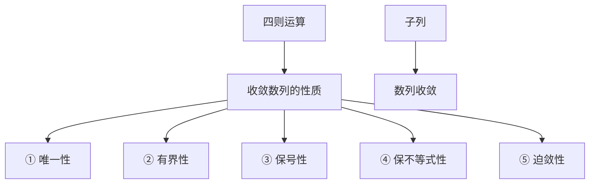
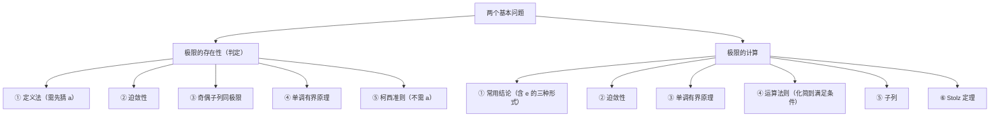
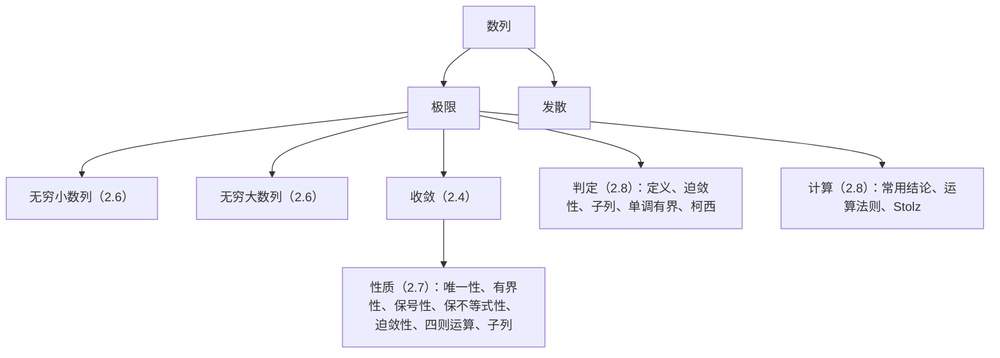

# 第二章 数列极限

> [!abstract] 本章导航
> **层级**：2.1 数列的定义 → 2.2 ε–N 定义 → 2.3 几何意义 → 2.4 收敛与发散 → 2.5 分式放缩 → 2.6 无穷小与无穷大数列 → 2.7 收敛数列的性质 → 2.8 极限存在的条件与计算
> **位置**：[[00 数学分析总索引]] ｜ 上一章：[[01 第一章 实数集与函数]]
> **依赖关系**：2.2 的定义用到第一章的**绝对值**（度量距离）与**邻域**（描述"附近"）；2.5 的"求 $N$"依赖**阿基米德性**保证 $N$ 的存在；2.6 用"非正常极限"把极限概念推广到无界情形；2.7 的性质是 2.8 全部判定与计算方法的依据，2.8 的柯西准则则**不必预知极限值**。

---

## 2.1 数列的定义

`关键词：数列极限的概念 · 数列的定义`

若函数 $f$ 的定义域为全体正整数集合 $\mathbb{N}_+$，则称

$$
f:\ \mathbb{N}_+\to\mathbb{R},\qquad \text{或}\quad f(n),\ n\in\mathbb{N}_+
$$

为**数列**，简记为 $\{a_n\}$，其中 $a_n=f(n)$ 称为**通项**。

> [!info] 补充
> 通项的具体形式是"任意的"，可以是 $n^2$、$\sqrt{n}$、$\dfrac{1}{n}$ 等等（原笔记以红字注明"任意的"），它决定了数列的取值规律。数列的本质是"**正整数集上的函数**"，因此可以逐项枚举、可以讨论单调性，但不能直接谈连续性。

**标签**：#数学分析/极限/数列

---

## 2.2 数列极限的 ε–N 定义

`关键词：数列极限定义 · ☆关键：求 N`

> [!note] 定义（ε–N 定义）
> 设 $\{a_n\}$ 为数列，$a$ 为定数。若对**任给的正数** $\varepsilon$，总存在**正整数** $N$，使得当 $n>N$ 时，
> $$|a_n-a|<\varepsilon,$$
> 则称数列 $\{a_n\}$ **收敛于** $a$，定数 $a$ 称为数列 $\{a_n\}$ 的**极限**，记作
> $$\lim_{n\to\infty}a_n=a \quad\text{或}\quad a_n\to a\ (n\to\infty).$$

**两点说明（原笔记红字）**：

1. $N$ **仅依赖于** $\varepsilon$——给定 $\varepsilon$ 后 $N$ 随之确定，但**不是唯一的**（取更大的数同样成立）；
2. $|a_n-a|$ 是 $a_n$ 与 $a$ 之间的**距离**（原笔记以绿字标出），因此定义可用**邻域语言**叙述：$a_n\in U(a;\varepsilon)$。

> [!info] 补充：量词结构
> 定义写作 $\forall\varepsilon>0,\ \exists N\in\mathbb{N}_+,\ \forall n>N:\ |a_n-a|<\varepsilon$。三个量词的顺序**不可交换**：$N$ 可以依赖 $\varepsilon$，但绝不可以依赖 $n$——这正是"求 $N$"成为解题关键的根源。

**标签**：#数学分析/极限/定义 #数学分析/极限/ε-N

---

## 2.3 极限的几何意义

由 $|a_n-a|<\varepsilon$ 可推出

$$
a-\varepsilon<a_n<a+\varepsilon,\qquad\text{即}\quad a_n\in(a-\varepsilon,\ a+\varepsilon)=U(a;\varepsilon).
$$

**几何解释**：以 $a$ 为中心、$\varepsilon$ 为半径作邻域 $U(a;\varepsilon)$，则

- 所有下标 $n>N$ 的项 $a_n$ 全部落入该邻域内；
- 在该邻域**之外**，$\{a_n\}$ 至多只有**有限项**（至多 $N$ 项）。

```
        a−ε        a        a+ε
   ──────┼─────────┼─────────┼──────▶ x
     a₁ a₂ … a_N       a_{N+1} … a₃
                 （ε 邻域，长度 2ε）
```

> [!tip] 要点
> 极限只约束"**尾部**"，不约束"有限个开头项"——这就是"改变有限项不影响极限"的直观来源。等价说法：数列收敛 $\iff$ 任给 $\varepsilon>0$，邻域 $U(a;\varepsilon)$ 之外至多含有限项。

> [!info] 原图对照（第 6 页）
> 含 ε–N 定义、几何示意图、收敛与发散、分式放缩四部分内容。
> ![[笔记原图-06 数列极限的概念.jpg|620]]

**标签**：#数学分析/极限/几何意义 #数学分析/实数/邻域

---

## 2.4 收敛与发散

- **收敛**：数列有（有限的）极限，即存在 $a\in\mathbb{R}$ 使 $\lim\limits_{n\to\infty}a_n=a$；
- **发散**：数列无极限。

**标签**：#数学分析/极限/收敛性

---

## 2.5 分式放缩技巧

处理分式型 $|a_n-a|$ 时的常用放大手段：

1. **分子放大、分母不变** $\Rightarrow$ 分式放大；
2. **分母缩小、分子不变** $\Rightarrow$ 分式放大。

> [!info] 补充：放缩的目的与边界
> 目的是把 $|a_n-a|$ 放大为关于 $n$ 的简单表达式（如 $\dfrac{C}{n}$），再由 $\dfrac{C}{n}<\varepsilon$ 解出 $n>\dfrac{C}{\varepsilon}$，取 $N=\left[\dfrac{C}{\varepsilon}\right]$（或更大），从而落实"求 $N$"这一步。
> 两个约束：① 放缩必须朝"**变大**"方向，才能由大者小于 $\varepsilon$ 推出小者小于 $\varepsilon$；② 放大后的量仍须**趋于 $0$**，否则解不出 $N$。

**标签**：#数学分析/极限/证明技巧 #数学分析/不等式/放缩

---

## 2.6 无穷小数列与无穷大数列

`关键词：无穷小数列 · 无穷大数列`

### 2.6.1 无穷小数列

> [!note] 定义
> 若 $\lim\limits_{n\to\infty}a_n=0$，则称 $\{a_n\}$ 为**无穷小数列**。

> [!info] 补充：与极限的关系
> 无穷小数列不是"很小的数"，而是"**以 $0$ 为极限的数列**"——它描述的是变化趋势，不是数值大小。
> 由极限的四则运算，$a_n\to a\iff a_n-a\to 0$，即：**任何收敛数列都可写成"极限值 + 无穷小数列"**。这条等价关系把"收敛于 $a$"化归为"与 $a$ 之差为无穷小"，是后续处理极限运算的常用形式。

### 2.6.2 无穷大数列

> [!note] 定义
> 若数列 $\{a_n\}$ 以 $\infty$、$+\infty$、$-\infty$ 为**非正常极限**，则称 $\{a_n\}$ 为**无穷大数列**。

> [!info] 补充：非正常极限的 ε–N 式定义
> 上一定义中的"非正常极限"须先明确，均指"任给正数 $M$，从某项之后的所有项都落在 $M$ 所划的范围之外"：
> - $\lim\limits_{n\to\infty}a_n=\infty\iff \forall M>0,\ \exists N,\ \forall n>N:\ |a_n|>M$；
> - $\lim\limits_{n\to\infty}a_n=+\infty\iff \forall M>0,\ \exists N,\ \forall n>N:\ a_n>M$；
> - $\lim\limits_{n\to\infty}a_n=-\infty\iff \forall M>0,\ \exists N,\ \forall n>N:\ a_n<-M$。
> 与 2.2 的 ε–N 定义对照可见：$\varepsilon$ 是"要多近有多近"的**小**量，$M$ 是"要多远有多远"的**大**量，二者结构完全一致，只是不等号方向相反。

> [!tip] 辨析：三类对象的区别
> 1. **无穷小**刻画"趋近于 $0$"；**无穷大**刻画"绝对值无限增大"；二者都不是实数意义上的"数"。
> 2. 无穷大数列一定**发散**，且一定**无界**；但**无界数列未必是无穷大数列**。例如
>    $$a_n=\begin{cases}n, & n \text{ 为奇数},\\ 1, & n \text{ 为偶数},\end{cases}$$
>    该数列无界（奇数项可任意大），却不存在 $N$ 使 $n>N$ 后所有 $|a_n|>M$，故 $\lim a_n\ne\infty$。
> 3. 无穷小与无穷大互为倒数：若 $a_n\ne 0$ 且 $a_n\to 0$，则 $\dfrac{1}{a_n}\to\infty$；反之若 $a_n\to\infty$，则 $\dfrac{1}{a_n}\to 0$。

> [!info] 原图对照（第 7 页 · 修订稿）
> 同一页的修订版本：新增无穷小、无穷大两个定义，并把原本空白的"小结"栏补成结构图。
> ![[笔记原图-07 数列极限的概念 修订稿.png|620]]

**标签**：#数学分析/极限/无穷小 #数学分析/极限/无穷大

---

## 2.7 收敛数列的性质

`关键词：收敛数列的性质`

### 2.7.1 唯一性

若数列 $\{a_n\}$ 收敛，则它**只有一个**极限。

### 2.7.2 有界性

若数列 $\{a_n\}$ 收敛，则 $\{a_n\}$ 为**有界数列**，即存在正数 $M$，使得对一切正整数 $n$，都有

$$
|a_n|\le M .
$$

（原笔记以红字标注：这是数列收敛的**必要条件**。）

> [!info] 补充：必要而不充分
> 有界只是收敛的必要条件，并非充分条件。例如 $a_n=(-1)^n$ 有界（$|a_n|=1$），却发散。
> 因此"有界"不能用来判定收敛，只能用来否定收敛——**无界必发散**。

### 2.7.3 保号性

若 $\lim\limits_{n\to\infty}a_n=a>0$（或 $a<0$），则对任意 $a'\in(0,a)$（或 $a'\in(a,0)$），存在正整数 $N$，使得当 $n>N$ 时有

$$
a_n>a' .
$$

> [!tip] 直观理解
> 一个数列最终越来越接近某个正数，那么它**从某项起必然全为正**；若极限为负，则从某项起全为负。
> 保号性的价值在于"以极限的符号推断数列项的符号"，是判断数列项正负、开方合法性的常用依据。

### 2.7.4 保不等式性

设 $\{a_n\}$ 和 $\{b_n\}$ 均收敛，若存在正整数 $N$，使得当 $n>N$ 时有

$$
a_n\le b_n,
$$

则

$$
\lim_{n\to\infty}a_n\le \lim_{n\to\infty}b_n .
$$

> [!info] 补充：不等号不可加强
> 结论中的 $\le$ 不能换成 $<$。即使对一切 $n$ 都有 $a_n<b_n$，也只能推出 $\lim a_n\le\lim b_n$。
> 例如 $a_n=0,\ b_n=\dfrac{1}{n}$，恒有 $a_n<b_n$，但两者极限都等于 $0$。

### 2.7.5 迫敛性

设数列 $\{a_n\}$ 和 $\{b_n\}$ 都以 $a$ 为极限，数列 $\{c_n\}$ 满足：存在正整数 $N$，当 $n>N$ 时有

$$
a_n\le c_n\le b_n,
$$

则数列 $\{c_n\}$ 收敛，且

$$
\lim_{n\to\infty}c_n=a .
$$

> [!info] 补充：证明思路
> 当 $n>N$ 时，由 $a_n-a\le c_n-a\le b_n-a$ 得 $|c_n-a|\le\max\{|a_n-a|,\ |b_n-a|\}$。任给 $\varepsilon>0$，取 $N'$ 使 $n>N'$ 时上式右端小于 $\varepsilon$，即得 $|c_n-a|<\varepsilon$。
> 迫敛性的意义：**不必知道 $\{c_n\}$ 的极限是什么**，只要用两个已知极限的数列把它"夹住"。

### 2.7.6 四则运算

若 $\{a_n\}$ 和 $\{b_n\}$ 均收敛，则 $\{a_n+b_n\}$、$\{a_n-b_n\}$、$\{a_nb_n\}$ 也收敛，且有

$$
\lim_{n\to\infty}(a_n\pm b_n)=\lim_{n\to\infty}a_n\pm\lim_{n\to\infty}b_n,
$$

$$
\lim_{n\to\infty}(a_nb_n)=\lim_{n\to\infty}a_n\cdot\lim_{n\to\infty}b_n .
$$

若 $b_n\ne 0$ 且 $\lim\limits_{n\to\infty}b_n\ne 0$，则 $\left\{\dfrac{a_n}{b_n}\right\}$ 也收敛，且有

$$
\lim_{n\to\infty}\frac{a_n}{b_n}=\frac{\lim\limits_{n\to\infty}a_n}{\lim\limits_{n\to\infty}b_n}.
$$

> [!info] 补充：使用前提
> 三条法则的共同前提是**两个极限都存在**；商的法则还额外要求**分母的极限不为零**。前提不满足时法则失效，须改用其他方法（见 [[02 第二章 数列极限#2.8 数列极限存在的条件与计算方法|2.8]]）。

### 2.7.7 子列

**定义**：设 $\{a_n\}$ 为数列，$\{n_k\}$ 为正整数集 $\mathbb{N}_+$ 的无限子集，且

$$
n_1<n_2<\cdots<n_k<\cdots,
$$

则数列 $\{a_{n_k}\}$ 称为 $\{a_n\}$ 的一个**子列**。

> [!success] 定理
> 数列 $\{a_n\}$ 收敛 $\iff$ $\{a_n\}$ 的**任何**子列都收敛于**同一数值**。

> [!info] 补充：实用推论
> 1. **顺向用**：若 $a_n\to a$，则其任何子列 $a_{n_k}\to a$——所以子列继承了原数列的极限。
> 2. **逆向用（证明发散）**：只要找到两个极限不同的子列，或找到一个发散的子列，即可断定原数列发散。
>    例如 $a_n=(-1)^n$，取 $a_{2k}=1$、$a_{2k-1}=-1$，两个子列极限不同，故 $\{a_n\}$ 发散。
> 3. 子列的下标必须是**无限集**且**严格递增**；因此"取前 $N$ 项""取所有奇数项的前 100 个"之类都不是子列。

### 2.7.8 小结



> [!tip] 读图要点
> 前五条是"**收敛 ⟹ 具备某性质**"的顺向结论，主要用于**估计与放缩**；四则运算是把已知极限组装成新极限；而"子列 → 数列收敛"是唯一可以**反向判定收敛**的工具（配合 2.8 的奇偶子列判别）。

**标签**：#数学分析/极限/收敛数列性质 #数学分析/极限/子列

---

## 2.8 数列极限存在的条件与计算方法

`关键词：极限的存在性（收敛的判断）· 极限的计算`

### 2.8.1 两个基本问题

本章的判定与计算可归为两条主线：

1. **极限的存在性**（收敛的判断）：给定数列，如何断定它收敛；
2. **极限的计算**：在确认收敛的前提下，如何求出极限值。

两者的关系是：**判定在前，计算在后**——先确认极限存在，四则运算等法则才有合法对象。

### 2.8.2 判定收敛的五条途径

**① 用定义（ε–N）**

$$
\lim_{n\to\infty}a_n=a\iff \forall\varepsilon>0,\ \exists N\in\mathbb{N}_+,\ \text{当 } n>N \text{ 时},\ |a_n-a|<\varepsilon .
$$

> [!tip] 用法
> 定义法**必须先猜出（或算出）极限 $a$**，再验证不等式。它是最根本的判据，但通常不是最省力的。

**② 迫敛性（两边夹法则）**

- ① 存在 $N_0$，当 $n>N_0$ 时有 $a_n\le c_n\le b_n$；
- ② $\lim\limits_{n\to\infty}a_n=\lim\limits_{n\to\infty}b_n=a$；

则数列 $\{c_n\}$ 收敛，且 $\lim\limits_{n\to\infty}c_n=a$。（表述与证明见 [[02 第二章 数列极限#2.7 收敛数列的性质|2.7.5]]）

**③ 用子列**

$$
\lim_{n\to\infty}a_n=a\iff \lim_{n\to\infty}a_{2n}=\lim_{n\to\infty}a_{2n+1}=a .
$$

即：**奇、偶两个子列收敛于同一数值**是原数列收敛的充要条件。常见的等价写法是 $\lim\limits_{n\to\infty}a_{2n-1}=\lim\limits_{n\to\infty}a_{2n}=a$（奇偶下标取法不同，含义相同）。

**④ 单调有界原理**

- 单调**增加**且有**上界**的数列必收敛，且极限为**上确界**；
- 单调**减少**且有**下界**的数列必收敛，且极限为**下确界**。

> [!tip] 用法
> 单调有界原理**不给出极限值**，只保证极限存在。故典型用法是：先用它证明 $\{a_n\}$ 收敛，再对递推式两边取极限解出 $a$（常用[[01 第一章 实数集与函数#1.6 有界集与确界原理|确界]]或方程确定该值）。

**⑤ 柯西（Cauchy）收敛准则**

数列 $\{a_n\}$ 收敛 $\iff$ 对任意 $\varepsilon>0$，存在 $N>0$，当 $n,m>N$ 时，有

$$
|a_n-a_m|<\varepsilon .
$$

> [!tip] 价值
> 柯西准则的判据只涉及 $\{a_n\}$ 自身，**不需要预先知道极限值 $a$**，这是它相对定义法的根本优势。

### 2.8.3 极限计算的常用结论

**① 幂函数型**

$$
\lim_{n\to\infty}\frac{1}{n^\alpha}=0\quad(\alpha>0).
$$

**② 指数型**

$$
\lim_{n\to\infty}q^n=0\quad(|q|<1).
$$

**③ 常数的方根**

$$
\lim_{n\to\infty}\sqrt[n]{a}=1\quad(a>0).
$$

**④ 幂的方根**

$$
\lim_{n\to\infty}\sqrt[n]{n^k}=1\quad(k\in\mathbb{N}_+).
$$

特别地，取 $k=1$ 得 $\lim\limits_{n\to\infty}\sqrt[n]{n}=1$。

**⑤ 根式与极限的交换**

设 $a_n\ge 0$，$\lim\limits_{n\to\infty}a_n=a$，则

$$
\lim_{n\to\infty}\sqrt{a_n}=\sqrt{a}=\sqrt{\lim_{n\to\infty}a_n}.
$$

即：**平方根运算与求极限可以交换次序**。注意它与 ③④ 的区别——③④ 的根指数是 $n$（$\sqrt[n]{\ }$，随 $n$ 变化），⑤ 是固定的平方根，属于"函数连续性与极限交换"，二者不是同一类结论。

> [!info] 补充：为什么可以交换
> 平方根函数在 $[0,+\infty)$ 上连续，故可与极限交换。也可直接估计：对 $x,y\ge 0$ 有
> $$|\sqrt{x}-\sqrt{y}|\le\sqrt{|x-y|},$$
> 取 $x=a_n,\ y=a$ 得 $|\sqrt{a_n}-\sqrt{a}|\le\sqrt{|a_n-a|}$。于是任给 $\varepsilon>0$，取 $N$ 使 $n>N$ 时 $|a_n-a|<\varepsilon^{2}$，即得 $|\sqrt{a_n}-\sqrt{a}|<\varepsilon$。

**⑥ 重要公式 $e$（基础型）**

$$
\lim_{n\to\infty}\left(1+\frac{1}{n}\right)^{n}=e .
$$

**推广型 1**：若 $\lim\limits_{n\to\infty}f(n)=\infty$，则

$$
\lim_{n\to\infty}\left(1+\frac{1}{f(n)}\right)^{f(n)}=e .
$$

**推广型 2**：若 $\lim\limits_{n\to\infty}g(n)=0$，则

$$
\lim_{n\to\infty}\left(1+g(n)\right)^{\frac{1}{g(n)}}=e .
$$

> [!tip] 三种形式的关系
> 基础型是 $f(n)=g(n)=n$ 的特例；三个式子的共同结构都是"$1+$ 无穷小"的"倒数次幂"。使用时先凑成 $\left(1+\square\right)^{1/\square}$ 的形状，再套公式。

### 2.8.4 极限运算法则及其适用条件

用初等运算、变量代换、恒等变形等方法将极限式化简，再由极限的四则运算、复合运算法则求出极限，是极限运算最基本的方法。

因为极限四则运算法则的条件是：**有限项**，**各项极限均存在**，**分母的极限不为零**，所以化简的过程就是使极限式满足运算条件的过程。

> [!info] 补充：这句话的含义
> 上述三个条件中任意一条不满足，就不能直接拆开算。常见的"化简"动作包括：约去公因子、有理化、分子分母同除最高次幂、拆项、变量代换——目的都是把"$\frac{\infty}{\infty}$、$\infty-\infty$、$0\cdot\infty$"等未定式，化为极限存在且分母非零的有限项之和。

### 2.8.5 Stolz 定理

**条件**：

1. $\{b_n\}$ 严格单调递增，且 $\lim\limits_{n\to\infty}b_n=+\infty$；
2. $\lim\limits_{n\to\infty}\dfrac{a_{n+1}-a_n}{b_{n+1}-b_n}=a$（$a$ 为有限数，或 $+\infty$，或 $-\infty$）。

**结论**：

$$
\lim_{n\to\infty}\frac{a_n}{b_n}=\lim_{n\to\infty}\frac{a_{n+1}-a_n}{b_{n+1}-b_n},
$$

或者（后向形式）

$$
\lim_{n\to\infty}\frac{a_n}{b_n}=\lim_{n\to\infty}\frac{a_n-a_{n-1}}{b_n-b_{n-1}}.
$$

> [!info] 补充：适用范围
> Stolz 定理处理 $\dfrac{\infty}{\infty}$ 型，可视为"数列版的洛必达法则"：把分子分母各自作差，化差分为商。
> 另有针对 $\dfrac{0}{0}$ 型的版本（要求 $\{b_n\}$ 严格递减且趋于 $0$），本笔记未涉及。

### 2.8.6 小结



> [!tip] 读图要点
> 左右两栏的条目**高度重叠**（迫敛性、单调有界、子列在两侧都出现），但用法不同：判定侧问"**是否收敛**"，计算侧问"**极限是多少**"。同一工具在两侧扮演不同角色——这也是本章复习时最容易混淆的地方。

> [!info] 原图对照（第 8 页）
> 收敛数列的性质：唯一性、有界性、保号性、保不等式性、迫敛性、四则运算、子列与子列定理。
> ![[笔记原图-08 收敛数列的性质.png|620]]

> [!info] 原图对照（第 9 页）
> 数列极限存在的条件与计算方式：五条判定途径与六类计算工具。
> ![[笔记原图-09 极限存在的条件与计算.png|620]]

**标签**：#数学分析/极限/存在性判定 #数学分析/极限/计算方法 #数学分析/极限/Stolz

---

## 本章小结



> [!tip] 读图要点
> 全章的落点只有两个方向：**收敛**（极限存在且有限）与**发散**（极限不存在）。"无穷小 / 无穷大"把极限概念向外扩展成两条支路——一条趋向 $0$，一条趋向 $\pm\infty$，后者正是"发散"中结构最规整的一类。
> 2.7 与 2.8 则把"收敛"这一判断落到实处：**先由性质提供估计工具，再由判定方法确认存在，最后由计算方法求出数值**。

> [!quote] 返回
> [[00 数学分析总索引]] ｜ [[01 第一章 实数集与函数]]
