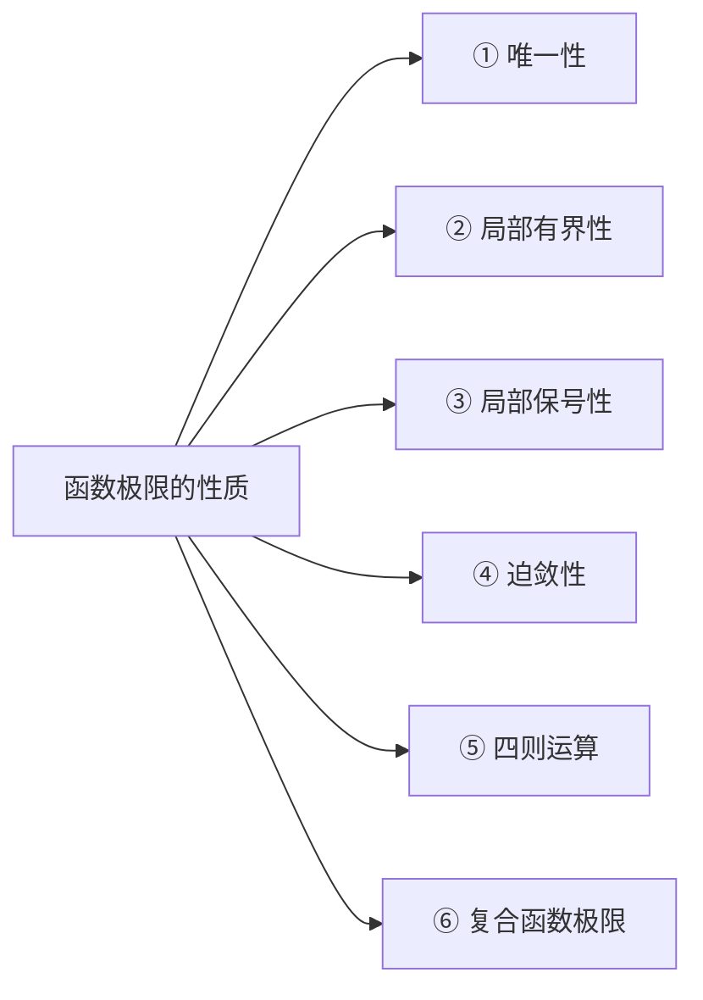
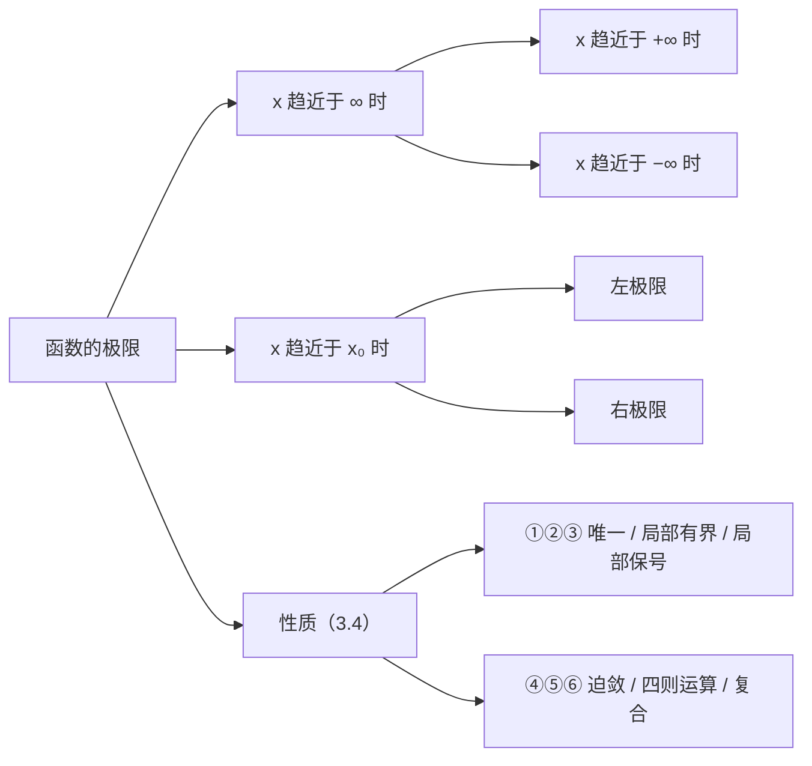

# 第三章 函数极限

> [!abstract] 本章导航
> **层级**：3.1 $x\to\infty$ 时函数的极限（ε–M）→ 3.2 $x\to x_0$ 时函数的极限（ε–δ）→ 3.3 五种定义的对照
> **位置**：[[00 数学分析总索引]] ｜ 上一章：[[02 第二章 数列极限]]
> **承接**：第二章用 ε–N 量化"$n$ 无限增大"，本章把"自变量无限接近"量化为 ε–M（自变量趋于无穷）与 ε–δ（自变量趋于有限点）。工具仍是**绝对值**（度量误差）与**邻域**（描述附近），只是自变量的取值方式从"离散的 $n$"变成了"连续的 $x$"。

---

## 3.1 x 趋近于 ∞ 时函数的极限

`关键词：x → +∞ 与 x → −∞ 的 ε–M 定义`

### 3.1.1 x → +∞ 时的极限

> [!note] 定义（ε–M）
> $\forall\varepsilon>0$，$\exists M>0$，使得当 $x>M$ 时，有
> $$|f(x)-L|<\varepsilon,$$
> 记为
> $$\lim_{x\to+\infty}f(x)=L .$$

> [!tip] 文字表述（原笔记红字）
> 无论给定多么小的正数 $\varepsilon$，总能找到一个正数 $M$，只要 $x$ 大于 $M$，函数值 $f(x)$ 就与 $L$ 的误差小于 $\varepsilon$。

### 3.1.2 x → −∞ 时的极限

> [!note] 定义（ε–M）
> $\forall\varepsilon>0$，$\exists M>0$，使得当 $x<-M$ 时有 $|f(x)-L|<\varepsilon$，记为
> $$\lim_{x\to-\infty}f(x)=L .$$

> [!tip] 文字表述（原笔记红字）
> 无论给定多么小的正数 $\varepsilon$，总能找到一个正数 $M$，只要 $x$ 小于 $-M$，函数值 $f(x)$ 就与 $L$ 的误差小于 $\varepsilon$。

### 3.1.3 两者的关系

> [!success] 定理
> $$\lim_{x\to\infty}f(x)=L\iff \lim_{x\to+\infty}f(x)=\lim_{x\to-\infty}f(x)=L .$$

> [!info] 补充：记号 $\lim\limits_{x\to\infty}$ 的含义
> 3.1.1 与 3.1.2 分别定义了 $x\to+\infty$、$x\to-\infty$ 两个过程，二者合起来才构成"$x$ 趋于无穷"，记作 $x\to\infty$。
> 上式说明：**$\lim\limits_{x\to\infty}$ 不是第三种独立定义**，它要求两侧**都存在且相等**；只要有一侧不存在、或两侧不相等，$\lim\limits_{x\to\infty}f(x)$ 就不存在。

> [!info] 补充：与左右极限的关系同构
> 对照 3.2.3：$\lim\limits_{x\to x_0}f(x)=L\iff \lim\limits_{x\to x_0^{+}}f(x)=\lim\limits_{x\to x_0^{-}}f(x)=L$。
> 两式形状完全相同——**"整体极限存在 $\iff$ 两个方向的极限存在且相等"**。差别只在于"两侧"是 $x_0$ 的左右邻域，还是 $x$ 轴的左右两端。
> 例：$\arctan x$ 满足 $\lim\limits_{x\to+\infty}\arctan x=\dfrac{\pi}{2}$、$\lim\limits_{x\to-\infty}\arctan x=-\dfrac{\pi}{2}$，两侧不等，故 $\lim\limits_{x\to\infty}\arctan x$ 不存在。

> [!info] 补充：计算时的化归
> 与上述定理不同的另一个恒等式（常用于计算）：
> $$\lim_{x\to-\infty}f(x)=\lim_{t\to+\infty}f(-t).$$
> 它把"$x$ 趋于 $-\infty$"换成"$t$ 趋于 $+\infty$"，使论证只需建立一套 ε–M。

> [!info] 补充：ε–M 的邻域表述
> $x>M$ 即 $x\in(M,+\infty)=U(+\infty;M)$。故 ε–M 定义可读作：任给 $\varepsilon>0$，存在**无穷邻域** $U(+\infty;M)$，使 $x$ 落入其中时 $f(x)\in U(L;\varepsilon)$。这正是第一章"无穷邻域"的用处。

---

## 3.2 x 趋近于 x₀ 时函数的极限

`关键词：ε–δ 定义 · 左极限与右极限`

### 3.2.1 定义（ε–δ）

> [!note] 定义（ε–δ）
> $\forall\varepsilon>0$，$\exists\delta>0$，使得当 $0<|x-x_0|<\delta$ 时，有
> $$|f(x)-L|<\varepsilon,$$
> 记作
> $$\lim_{x\to x_0}f(x)=L .$$

> [!tip] 文字表述（原笔记红字）
> 无论给定多么小的正数 $\varepsilon$，总能找到一个正数 $\delta$，只要 $x$ 与 $x_0$ 的距离小于 $\delta$ 但不等于 $0$，函数值 $f(x)$ 与 $L$ 的误差就小于 $\varepsilon$。

> [!info] 补充：为什么是 $0<|x-x_0|$
> 两个要点：
> ① $|x-x_0|<\delta$ 表示 $x\in U(x_0;\delta)$；
> ② 左端的 $0<$ 把 $x=x_0$ 挖去，考察的是**去心邻域** $U^{\circ}(x_0;\delta)$。
>
> 由此可得一个常被忽略的结论：**$f$ 在 $x_0$ 处可以没有定义，极限依然可能有意义**——极限只关心 $x_0$ 附近，不关心 $x_0$ 这一点本身。

### 3.2.2 左极限与右极限

**左极限**（$x$ 从 $x_0$ 的左侧逼近，即 $x<x_0$）：

> [!note] 定义（左极限）
> $\forall\varepsilon>0$，$\exists\delta>0$，当 $0<x_0-x<\delta$ 时，有 $|f(x)-L|<\varepsilon$，记为
> $$\lim_{x\to x_0^{-}}f(x)=L .$$

**右极限**（$x$ 从 $x_0$ 的右侧逼近，即 $x>x_0$）：

> [!note] 定义（右极限）
> $\forall\varepsilon>0$，$\exists\delta>0$，当 $0<x-x_0<\delta$ 时，有 $|f(x)-L|<\varepsilon$，记为
> $$\lim_{x\to x_0^{+}}f(x)=L .$$

**左极限与右极限统称为单侧极限。** 下文 3.2.3 讨论的"双侧极限与单侧极限的关系"，即指双侧极限与左、右极限之间的关系。

> [!info] 补充：关于定名与记法
> 原稿第 1 条标为"左极限"，但所给条件是 $0<x-x_0<\delta$（即 $x>x_0$）、记号亦为 $x\to x_0^{+}$，二者都指向**右极限**；第 2 条情形对称。此处按不等式方向与记号定名，条件与下标完全照原稿保留。
> 记号的其他写法：$x\to x_0^{+}$ 可写作 $x\to x_0+0$，$x\to x_0^{-}$ 可写作 $x\to x_0-0$。两个不等式也可合并写成 $0<|x-x_0|<\delta$ 再附加 $x>x_0$（或 $x<x_0$）。

### 3.2.3 双侧极限与单侧极限的关系

> [!success] 定理
> $$\lim_{x\to x_0}f(x)=L\iff \lim_{x\to x_0^{+}}f(x)=\lim_{x\to x_0^{-}}f(x)=L .$$

> [!info] 补充：两个方向的用法
> ① **判定存在**：分别求出左、右极限，若都存在且相等，则双侧极限存在且等于该值；此时可避开两侧同时控制的麻烦。
> ② **判定不存在**：只要左、右极限有一个不存在，或两者不相等，双侧极限就不存在。
> 例：$f(x)=\dfrac{\lvert x\rvert}{x}$ 在 $x_0=0$ 处，右极限为 $1$、左极限为 $-1$，故 $\lim\limits_{x\to 0}\dfrac{\lvert x\rvert}{x}$ 不存在。

---

## 3.3 五种定义的对照

| 过程 | 控制自变量的量 | 条件 | 结论 | 记号 |
| :-- | :-- | :-- | :-- | :-- |
| $x\to+\infty$ | $M>0$ | $x>M$ | $\lvert f(x)-L\rvert<\varepsilon$ | $\lim\limits_{x\to+\infty}f(x)=L$ |
| $x\to-\infty$ | $M>0$ | $x<-M$ | $\lvert f(x)-L\rvert<\varepsilon$ | $\lim\limits_{x\to-\infty}f(x)=L$ |
| $x\to x_0$ | $\delta>0$ | $0<\lvert x-x_0\rvert<\delta$ | $\lvert f(x)-L\rvert<\varepsilon$ | $\lim\limits_{x\to x_0}f(x)=L$ |
| $x\to x_0^{+}$ | $\delta>0$ | $0<x-x_0<\delta$ | $\lvert f(x)-L\rvert<\varepsilon$ | $\lim\limits_{x\to x_0^{+}}f(x)=L$ |
| $x\to x_0^{-}$ | $\delta>0$ | $0<x_0-x<\delta$ | $\lvert f(x)-L\rvert<\varepsilon$ | $\lim\limits_{x\to x_0^{-}}f(x)=L$ |

> [!tip] 读表要点
> 五行的结构完全一致：**$\forall\varepsilon>0$，$\exists$ 一个控制自变量的正数（$M$ 或 $\delta$），当 $x$ 进入指定范围时，函数值与 $L$ 的误差小于 $\varepsilon$**。
> $\varepsilon$ 永远管"纵向"的误差，$M$ 与 $\delta$ 永远管"横向"的范围；区别只在于 $x$ 是趋于无穷还是趋于有限点。
>
> 表中未列 $\lim\limits_{x\to\infty}f(x)$：它不是独立的一种定义，而是要求 $x\to+\infty$ 与 $x\to-\infty$ 两侧同时成立且相等，见 3.1.3。

---

## 3.4 函数极限的性质

`关键词：函数极限的性质`　（原笔记提示：函数极限的性质与数列极限的性质具有较高相似性）

> [!info] 补充：与 [[02 第二章 数列极限#2.7 收敛数列的性质|2.7 收敛数列的性质]] 的逐条对应
> | 性质 | 数列极限（2.7） | 函数极限（3.4） |
> | :-- | :-- | :-- |
> | 唯一性 | 极限唯一 | 同 |
> | 有界性 | 整个数列有界 | 只在 $x_0$ 的某**空心邻域**内有界 |
> | 保号性 | 从某项起与极限同号 | 在某**空心邻域**内与极限同号 |
> | 迫敛性 | 两个数列夹逼 | 两个函数夹逼 |
> | 四则运算 | 加、减、乘、除 | 同 |
> | 复合 | 本章无对应条目 | **复合函数极限定理**（需 $f(x)\neq u_0$） |
>
> 唯一的实质差别是"**局部**"二字：数列的"最终"是全称的（除有限项外全部成立），函数的"附近"是局部的（只在某个邻域内成立）。

### 3.4.1 唯一性

若极限 $\lim\limits_{x\to x_0}f(x)$ 存在，则此极限是**唯一的**。

### 3.4.2 局部有界性

若 $\lim\limits_{x\to x_0}f(x)$ 存在，则 $f$ 在 $x_0$ 的**某空心邻域** $U^{\circ}(x_0)$ 上有界。

> [!info] 补充：局部有界性的确切含义
> 即存在 $M>0$ 与 $\delta>0$，使当 $0<|x-x_0|<\delta$ 时 $|f(x)|\le M$。
> 两点须注意：① 只保证**某一个**邻域内有界，该邻域可以很小；② 不涉及 $x=x_0$ 这一点，故 $f$ 在 $x_0$ 处甚至可以不定义。

### 3.4.3 局部保号性

若 $\lim\limits_{x\to x_0}f(x)=A>0$（或 $A<0$），则对任何正数 $r<A$（或 $r<-A$），存在 $U^{\circ}(x_0)$，使得对一切 $x\in U^{\circ}(x_0)$，都有

$$
f(x)>r>0\qquad\left(\text{或 } f(x)<-r<0\right).
$$

> [!info] 补充：$r$ 的作用
> 取 $r=\dfrac{A}{2}$ 是最常用的特例：此时 $f(x)>\dfrac{A}{2}>0$，即函数值不仅与极限同号，而且至少保留极限值的**一半**。
> 注意 $r$ 必须是正数：若允许 $r\le 0$，结论就退化为"$f(x)$ 与 $A$ 同号"的弱形式，不再保证有正的下界。

### 3.4.4 迫敛性

设 $\lim\limits_{x\to x_0}f(x)=\lim\limits_{x\to x_0}g(x)=A$，且在某 $U^{\circ}(x_0;\delta')$ 上有

$$
f(x)\le h(x)\le g(x),
$$

则

$$
\lim_{x\to x_0}h(x)=A .
$$

### 3.4.5 四则运算

与数列极限相似：若 $\lim\limits_{x\to x_0}f(x)$、$\lim\limits_{x\to x_0}g(x)$ 都存在，则

$$
\lim_{x\to x_0}\left[f(x)\pm g(x)\right]=\lim_{x\to x_0}f(x)\pm\lim_{x\to x_0}g(x),\qquad
\lim_{x\to x_0}\left[f(x)g(x)\right]=\lim_{x\to x_0}f(x)\cdot\lim_{x\to x_0}g(x);
$$

当 $\lim\limits_{x\to x_0}g(x)\neq 0$ 时，

$$
\lim_{x\to x_0}\frac{f(x)}{g(x)}=\frac{\lim\limits_{x\to x_0}f(x)}{\lim\limits_{x\to x_0}g(x)} .
$$

> [!info] 补充
> 与 3.4.1–3.4.4 不同，四则运算**不需要"局部"限定**：它是恒等式，在极限存在处直接成立。前提仍是"两个极限都存在"与"分母极限不为零"。

### 3.4.6 复合函数极限

> [!success] 定理
> 设 $\lim\limits_{x\to x_0}f(x)=u_0$，$\lim\limits_{u\to u_0}g(u)=A$，且存在某空心邻域 $U^{\circ}(x_0;\delta)$，使得对任意 $x\in U^{\circ}(x_0;\delta)$ 有 $f(x)\neq u_0$，则
> $$\lim_{x\to x_0}g\bigl(f(x)\bigr)=A .$$

> [!info] 补充：条件 $f(x)\neq u_0$ 的作用
> 定理只要求 $g$ 在 $u_0$ 附近有定义、并以 $A$ 为极限，**$g$ 在 $u_0$ 处本身可以有定义也可以没有**。若 $f$ 在 $x_0$ 附近取到 $u_0$，代入后就会出现 $g(u_0)$，此时极限过程可能无意义。
> 该条件等价于保证"$0<|u-u_0|$"成立（见证明 ③），使 $g$ 的极限可以被合法使用。直观地说：复合函数的极限是"把 $f$ 的值送进 $g$ 的极限过程"，而极限过程必须**去掉中心点**。

**证明**（笔记原文，编号照录）：

∵ $\lim\limits_{u\to u_0}g(u)=A$，∴ $\forall\varepsilon>0$，$\exists\eta>0$，使得当 $0<|u-u_0|<\eta$ 时，有

$$
|g(u)-A|<\varepsilon . \qquad (①)
$$

∵ $\lim\limits_{x\to x_0}f(x)=u_0$，∴ 对于上面找到的 $\eta>0$，必定存在 $\delta_1>0$，使得当 $0<|x-x_0|<\delta_1$ 时，有

$$
|f(x)-u_0|<\eta . \qquad (②)
$$

由是，当 $0<|x-x_0|<\delta_1$ 时，

$$
|f(x)-u_0|>0 . \qquad (③)
$$

取 $\delta'=\min\{\delta_1,\ \delta\}$，当 $0<|x-x_0|<\delta'$ 时，②③ 同时成立。

令 $u=f(x)$，有 $0<|u-u_0|<\eta$，代入 ① 得

$$
|g\bigl(f(x)\bigr)-A|<\varepsilon ,
$$

故

$$
\lim_{x\to x_0}g\bigl(f(x)\bigr)=A . \qquad\blacksquare
$$

### 3.4.7 小结

> [!info] 补充：为什么强调"局部"
> **极限只描述 $x$ 靠近 $x_0$ 时的行为，不控制远处。** 由 $\lim\limits_{x\to x_0}f(x)=A$ 只能推出"$x_0$ 附近"的信息，$f$ 在远离 $x_0$ 处可以任意大，故有界性、保号性都只能是局部的。

> [!info] 补充：为什么数列极限不强调"局部"
> 数列极限的"局部"是**尾部** $n>N$，而尾部之外只有**有限项**。有限项必定有界、且不会破坏符号，于是"尾部有界"可以升级为"整个数列有界"，"尾部同号"也可以说"从某项起同号"。
> 函数则不同：$x_0$ 的空心邻域之外有**无穷多个**点，无法像有限项那样收拢，因此只能停在"局部"。

> [!info] 原图对照（第 11 页）
> 函数极限的六条性质、复合函数极限定理及其证明、小结与"局部"的说明。
> ![[笔记原图-11 函数极限的性质.png|620]]

> [!info] 原图对照（第 10 页）
> 第三章开篇：函数极限的两种过程（$x\to\infty$、$x\to x_0$）与左、右极限。
> ![[笔记原图-10 函数极限的概念.png|620]]

## 小结

> [!tip] 读图要点
> 本章只有两种极限过程：**自变量趋于无穷**（细分为 $+\infty$ 与 $-\infty$，二者可由 $t=-x$ 互相转化）与**自变量趋于有限点**（细分为左、右极限，二者相等时合并为双侧极限）。
> 两个分叉都不是并列的四种独立定义，而是"一个模型 + 若干变体"：$+\infty$ 与 $-\infty$ 共用 ε–M 模型，左、右极限共用 ε–δ 模型，只是把去心邻域换成单侧区间。

> [!quote] 返回
> [[00 数学分析总索引]] ｜ [[02 第二章 数列极限]]

**标签**：#数学分析/函数极限/ε-M #数学分析/函数极限/ε-δ #数学分析/函数极限/单侧极限 #数学分析/函数极限/性质 #数学分析/函数极限/复合函数
